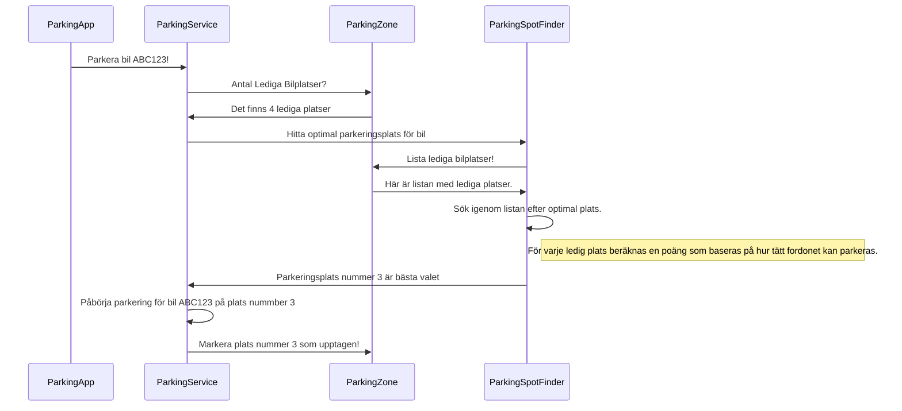
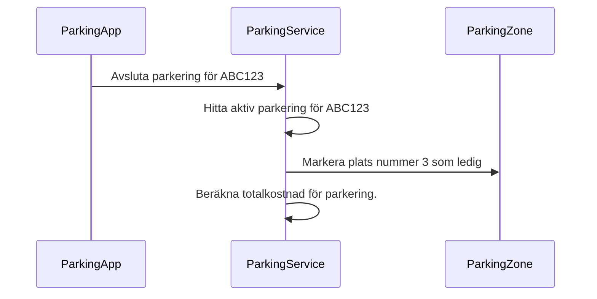


## **ParkingApp:** Hanterar interaktion med användare.
## **ParkingService** : Hanterar administration av aktiva parkeringar.
## **ParkingZone** : Hanterar  vilka platser som är lediga eller upptagna.
## **ParkingSpotFinder:** Har metoder för att hitta optimal plats för olika typer av fordon.

| Plats | Fordon |
| -------- | -------- |
| 1 | Bil qwe123 |
| 2 | Mc ert345 |
| 3 | _ |
| 4 | Bil rty567 |
| 5 | _ |
| 6 | _ |
| 7 | Bil fgh678 |
| 8| _|

***
# Parkera Bil 

| Plats | Fordon |
| -------- | -------- |
| 1 | Bil qwe123 |
| 2 | Mc ert345 |
| 3 | **Bil abc123** |
| 4 | Bil rty567 |
| 5 | _ |
| 6 | _ |
| 7 | Bil fgh678 |
| 8| _|

# Avsluta Parkering

| Plats | Fordon |
| -------- | -------- |
| 1 | Bil qwe123 |
| 2 | Mc ert345 |
| 3 | _ | 
| 4 | Bil rty567 |
| 5 | _ |
| 6 | _ |
| 7 | Bil fgh678 |
| 8| _|